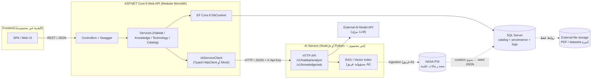
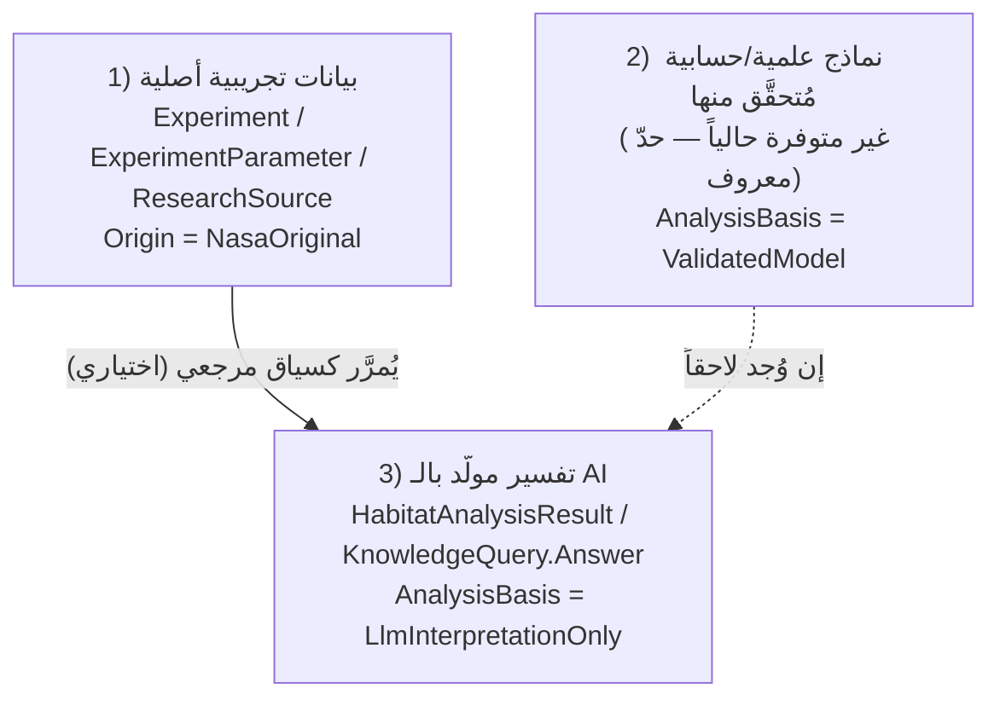
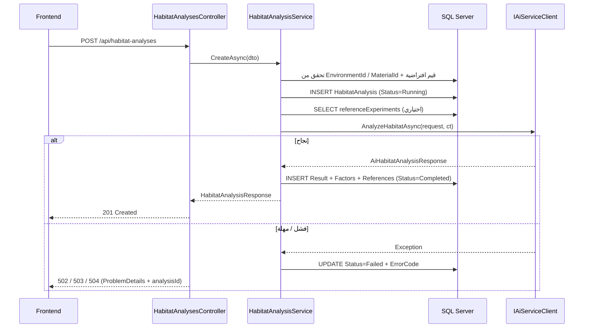

# architecture.md — NASA Fire Safety Intelligence Platform

> **الحالة:** مواصفة تصميم (لا يوجد كود). **الإصدار:** 0.1 — قابل للتعديل بعد التنسيق مع فريق الـ AI والـ Frontend.
> **الجمهور:** مطوّر الـ Backend (ASP.NET Core 8 / EF Core 8 / SQL Server).

---

## 0. نتائج فحص بيئة العمل (حسب تعليمات الخطوة 10)

| البند | النتيجة |
|---|---|
| مجلد المشروع / ملفات `.sln` أو `.csproj` | **غير موجود** في البيئة التي أُتيحت لي. |
| ملفات مرفوعة غير ملف المتطلبات | لا يوجد. |
| الاستنتاج | لا أستطيع الجزم بأن مشروع ASP.NET Core 8 أُنشئ عندك محلياً. **اليوم 1 يبدأ بإنشاء المشروع** (الأمر في `development-roadmap.md`). إن كان المشروع موجوداً بالفعل فتجاهل خطوة الإنشاء وطابق الهيكل أدناه معه. لم أكتب فوق أي ملف. |

### التحقق من NASA PSI (مصدر البيانات)

ما تأكدت منه عبر بحث ويب:

- **PSI = Physical Sciences Informatics**: مستودع بيانات مفتوح لتجارب العلوم الفيزيائية (ومنها Combustion Science) على ISS وغيرها، أُطلق 2014 وتمت ترقيته لنظام جديد في 2024.
- يحتوي على بيانات تجريبية وبيانات وصفية (metadata) ومنشورات وتقارير، وحصلت مجموعات البيانات على **DOIs**.
- حجمه كبير (أكثر من 100 مجموعة بيانات وحوالي 30 TB حسب إعلان NASA 2025).
- مصادر أقدم ذكرت أن الدخول يتطلب **تسجيلاً**؛ لم أتحقق إن كان ذلك ما زال مطلوباً.

ما **لم** أتمكن من التحقق منه:

- **لم أجد واجهة API عامة موثّقة** للاستعلام البرمجي من PSI. لذلك **لا أفترض وجودها**.
- صيغ الملفات داخل كل dataset، وشروط الترخيص/إعادة التوزيع.

> **القرار المعماري الناتج:** الـ Backend **لا يتصل بـ PSI وقت التشغيل (runtime)**. بيانات PSI تُنتقى يدوياً (curation) وتُحمَّل في SQL Server كـ catalog مع مراجعها، والملفات الكبيرة تبقى خارج قاعدة البيانات. التفاصيل في `database-design.md` §7.

---

## 1. تصنيف المحتوى: مؤكد / مقترح / مجهول

### 1.1 متطلبات مؤكدة (من ملف المتطلبات)

- .NET 8، Web API بـ Controllers، EF Core 8 (Code-First)، SQL Server، REST، Swagger.
- Modular Monolith، بدون Microservices/Kubernetes/Clean Architecture ثقيلة.
- الـ AI يطوّره عضوان آخران؛ الـ Backend يتكامل معه **فقط عبر HTTP بعقود محددة**.
- الـ Frontend لا يصل لقاعدة البيانات ولا لمفاتيح مزوّد الـ AI.
- يجب الحفاظ على **data provenance** والتمييز بين: (1) بيانات تجريبية، (2) نماذج علمية/حسابية مُتحقَّق منها، (3) تفسيرات مولَّدة بالـ AI.
- لا اختراع صيغ أو عتبات علمية.
- ~4 أيام: يومان تحضير + يومان مسابقة. يجب أن يعمل العرض حتى لو الـ AI غير جاهز (mock).

### 1.2 قرارات مقترحة (مني — قابلة للنقاش)

| # | القرار | السبب المختصر |
|---|---|---|
| D1 | مشروع واحد `NasaFireSafety.Api` بمجلدات مرتبة حسب النوع + اسم الـ feature في الـ Services | أبسط ما يلائم 4 أيام. |
| D2 | **إعادة تسمية `Simulation` → `HabitatAnalysis`** (و`SimulationResult` → `HabitatAnalysisResult`) | كلمة "simulation" توحي بنموذج حسابي مُتحقَّق منه، وهذا يناقض قيدك العلمي. الاسم الجديد صادق: هو تحليل مبني على مدخلات ومخرج AI. |
| D3 | `ResearchSource` كيان مركزي للـ provenance تشير إليه كل الجداول الأخرى | مصدر واحد للحقيقة للمراجع والـ DOI والروابط. |
| D4 | بيانات التجارب بنمط **`Experiment` + `ExperimentParameter`** (مفتاح/قيمة/وحدة) وليس أعمدة ثابتة | لأن تجارب PSI لا تتشارك نفس المعاملات. |
| D5 | كل مخرجات الـ AI تحمل `AnalysisBasis` (أساس التحليل) و`IsMock` وتُعرض بتحذير | منع عرض مخرج LLM كأنه نتيجة محقَّقة. |
| D6 | تنفيذ تحليل الـ Habitat **متزامن (sync)** في الـ MVP مع حقل `Status` وendpoint للاستعلام | يبسّط التنفيذ ويترك مجالاً للانتقال إلى async لاحقاً دون كسر العقد. (التبرير في `integration-contracts.md` §6) |
| D7 | لا Authentication في الـ MVP؛ مفتاح `X-Api-Key` بين الـ Backend والـ AI فقط + CORS مقيَّد | تقليل التعقيد. |
| D8 | DTOs عامة (للـ Frontend) **منفصلة** عن DTOs الـ AI | تغيّر عقد الـ AI لا يكسر الـ Frontend. |
| D9 | الـ Mapping يدوي (extension methods) بدون AutoMapper | تقليل الاعتمادات. |

### 1.3 أسئلة مجهولة تحتاج تنسيقاً

مجمّعة في `development-roadmap.md` §6 (الأهم: لغة/أسلوب خدمة الـ AI، مصدر الـ RAG corpus، هل يوجد نموذج علمي مُتحقَّق منه فعلاً، اختيار dataset من PSI، تقنية الـ Frontend).

---

## 2. المعمارية العامة

### 2.1 مخطط المكوّنات



**ملاحظات على الخطوط المتقطعة:** لا يوجد اتصال runtime من الـ Backend إلى PSI. المسار المتقطع هو عملية تجهيز بيانات تُنفَّذ قبل العرض.

### 2.2 مسؤوليات المكوّنات

| المكوّن | المسؤول | يفعل | لا يفعل |
|---|---|---|---|
| **Frontend** | Member 4 | واجهات الاختيار والعرض، يستدعي الـ Backend فقط، يعرض الـ disclaimers وشارات `analysisBasis`. | لا يتصل بـ DB أو الـ AI أو مزوّد LLM. |
| **ASP.NET Core API** | Member 1 (أنت) | validation، catalog، persistence، orchestrate استدعاء الـ AI، تحويل الأخطاء، ضمان وسم الـ provenance، إخفاء تفاصيل الـ AI عن الـ Frontend. | لا يُدرّب/يضبط نماذج، لا embeddings، لا RAG، لا يحكم علمياً على النتائج. |
| **SQL Server** | Member 1 | catalog التجارب والمواد والتقنيات والمراجع، سجل التحليلات والأسئلة. | لا يخزّن ملفات dataset الكبيرة. |
| **AI Service** | Members 2+3 | تنفيذ التحليل والـ RAG، التعامل مع مزوّد LLM، إرجاع citations بمعرّفات قابلة للمطابقة. | لا يكتب في قاعدة بيانات الـ Backend. |
| **External AI Model API** | طرف ثالث | توليد النص. | — |
| **NASA PSI** | NASA | المصدر العلمي الأصلي. | غير مُستدعى وقت التشغيل. |

### 2.3 المبدأ العلمي: ثلاث طبقات منفصلة



**حدّ معروف (Limitation) في الـ MVP:** حسب ما نعرف الآن لا يوجد نموذج علمي مُتحقَّق منه لتصنيف الخطر. إذاً ناتج Module 1 في الـ MVP هو **"تحليل استرشادي مولَّد بالـ AI مبني على مدخلات وتجارب مرجعية"** وليس تنبؤاً علمياً مُتحقَّقاً. هذا يظهر في:

- حقل `analysisBasis` (القيمة الافتراضية `LlmInterpretationOnly`).
- حقل `limitations` و`disclaimer` في الاستجابة.
- `isMock = true` عند استخدام الـ Mock.

**اقتراح MVP لتحسين الأساس العلمي دون اختراع صيغ:** يرسل الـ Backend للـ AI قائمة `referenceExperiments` (تجارب من SQL لها نفس المادة/ظروف قريبة) كسياق، ويحسب **فحص تغطية** (coverage check): هل مدخلات المستخدم داخل نطاق القيم الموجودة في التجارب المرجعية أم خارجه؟ هذا فحص إحصائي بسيط على البيانات المخزّنة (min/max) وليس نموذجاً علمياً، ويُعرض كتحذير "خارج نطاق التجارب المرجعية" (**Nice-to-have**).

---

## 3. هيكل مشروع الـ Backend

مشروع واحد. لا طبقات منفصلة (Domain/Application/Infrastructure) لأنها زيادة تعقيد لهذا الحجم.

```
NasaFireSafety.Api/
├── Program.cs
├── appsettings.json / appsettings.Development.json
├── Controllers/
│   ├── EnvironmentsController.cs
│   ├── MaterialsController.cs
│   ├── HabitatAnalysesController.cs
│   ├── KnowledgeController.cs
│   ├── ExperimentsController.cs
│   ├── SourcesController.cs
│   ├── TechnologiesController.cs
│   └── HealthController.cs
├── Entities/
│   ├── (SpaceEnvironment.cs, Material.cs, Experiment.cs, ... )
│   └── Enums/
├── DTOs/
│   ├── Common/        (PagedResponse<T>, ...)
│   ├── Habitat/
│   ├── Knowledge/
│   ├── Catalog/       (Experiments, Sources, Materials, Environments)
│   └── Technologies/
├── Data/
│   ├── AppDbContext.cs
│   ├── Configurations/   (IEntityTypeConfiguration<T> لكل كيان)
│   ├── Migrations/
│   └── Seed/             (SeedData/*.json + DbSeeder.cs)
├── Services/
│   ├── IHabitatAnalysisService.cs / HabitatAnalysisService.cs
│   ├── IKnowledgeService.cs / KnowledgeService.cs
│   ├── ICatalogService.cs / CatalogService.cs      (environments, materials, experiments, sources)
│   ├── ITechnologyService.cs / TechnologyService.cs
│   └── Mapping/  (extension methods Entity → DTO)
├── Integrations/
│   └── Ai/
│       ├── IAiServiceClient.cs
│       ├── HttpAiServiceClient.cs
│       ├── MockAiServiceClient.cs
│       ├── AiServiceOptions.cs
│       ├── AiServiceExceptions.cs
│       └── Contracts/    (DTOs الخاصة بعقد الـ AI فقط)
└── Middleware/
    ├── GlobalExceptionHandler.cs   (IExceptionHandler)
    └── CorrelationIdMiddleware.cs
```

| المجلد | المسؤولية | ملاحظة |
|---|---|---|
| `Controllers` | استقبال HTTP، تحقق أولي (`[ApiController]`)، استدعاء Service، إرجاع DTO. | بلا منطق أعمال. |
| `Entities` | نموذج الـ DB فقط. | لا تُعرض مباشرة أبداً. |
| `DTOs` | عقود الـ API العامة. | منفصلة عن `Integrations/Ai/Contracts`. |
| `Data` | DbContext، تهيئة الكيانات بـ Fluent API، الـ migrations، الـ seed. | استخدم `IEntityTypeConfiguration` لتبقى الـ DbContext نظيفة. |
| `Services` | منطق الأعمال: resolve للقيم الافتراضية، بناء طلب الـ AI، حفظ النتيجة، مطابقة الـ citations مع `ResearchSource`. | واجهة + تنفيذ لأغراض الـ DI والاختبار فقط. |
| `Integrations/Ai` | كل ما يخص التواصل مع الـ AI. | يُبدَّل Http/Mock بإعداد واحد. |
| `Middleware` | معالجة الأخطاء العامة + Correlation Id. | |

**ما لم أضفه عمداً:** Repository pattern (EF DbContext كافٍ)، MediatR، AutoMapper، FluentValidation، Unit of Work.

**الحزم المقترحة (قليلة):** `Microsoft.EntityFrameworkCore.SqlServer` و`.Design` (8.x)، Swashbuckle (يأتي مع قالب `webapi`). اختياري لاحقاً: `Microsoft.Extensions.Http.Resilience`.

---

## 4. تدفق الطلب الرئيسي (Module 1)



---

## 5. تصنيف الميزات (MVP scope)

| الفئة | ميزات |
|---|---|
| **Must-have** | catalog البيئات والمواد؛ `POST/GET /api/habitat-analyses` مع Mock ثم AI حقيقي؛ `POST /api/knowledge/queries`؛ `GET /api/experiments` و`/{id}`؛ `GET /api/sources/{id}`؛ `GET /api/technologies` و`/{id}`؛ seed data؛ معالجة أخطاء عالمية؛ Swagger؛ CORS. |
| **Nice-to-have** | فحص التغطية (coverage check)؛ سجل التحليلات `GET /api/habitat-analyses`؛ `MaterialProperty`؛ `SourceAsset`؛ endpoint `health/ai`؛ rate limiting على endpoints الـ AI؛ CRUD لإدارة الـ catalog. |
| **Future** | async jobs بـ `Channel`/`BackgroundService`؛ SQL Full-Text Search؛ مصادقة ومستخدمون؛ Streaming للإجابات؛ استيراد آلي من PSI إن توفرت واجهة؛ نموذج علمي مُتحقَّق منه؛ Caching؛ Observability. |
