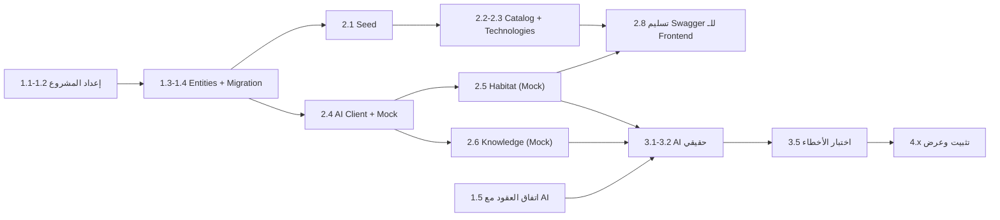

# development-roadmap.md — خطة التنفيذ (4 أيام)

> التقديرات تقريبية لمطوّر واحد. **القاعدة:** كل يوم ينتهي بشيء **يعمل ويمكن عرضه**، حتى لو بسيط.
> اليومان 1–2 = تحضير، اليومان 3–4 = المسابقة.

---

## 1. أولويات الـ MVP

| الفئة | المحتوى |
|---|---|
| **Must** | قاعدة البيانات والـ seed؛ catalog (بيئات، مواد، تجارب، مصادر، تقنيات)؛ `POST/GET habitat-analyses` (Mock ثم AI)؛ `POST knowledge/queries` (Mock ثم AI)؛ معالجة الأخطاء؛ Swagger؛ CORS؛ وسم الـ provenance والـ disclaimers |
| **Nice** | coverage check؛ سجل التحليلات؛ `MaterialProperty`؛ `SourceAsset`؛ health/ai؛ rate limiting؛ CRUD للـ catalog |
| **Future** | async jobs؛ Full-Text Search؛ مصادقة؛ استيراد آلي من PSI؛ نموذج علمي مُتحقَّق؛ streaming |

---

## 2. الخطة اليومية

### اليوم 1 (تحضير) — الأساس + الاتفاق على العقود

| # | المهمة | تقدير | ناتج |
|---|---|---|---|
| 1.1 | إنشاء/فحص المشروع: `dotnet new webapi --use-controllers -n NasaFireSafety.Api -f net8.0`، إضافة حزم EF Core SQL Server/Design، Git + `.gitignore` | 0.5 س | مشروع يعمل + Swagger |
| 1.2 | هيكل المجلدات + `appsettings` + User Secrets + CORS + `GlobalExceptionHandler` + `CorrelationIdMiddleware` | 1.5 س | |
| 1.3 | كتابة الـ Entities + Enums + `IEntityTypeConfiguration` (انظر `database-design.md` §8) | 3 س | |
| 1.4 | `AppDbContext` + أول migration + `database update` على SQL Server (LocalDB أو Docker) | 1 س | قاعدة بيانات تُبنى |
| 1.5 | **اجتماع مع فريق الـ AI** — مراجعة العقود المؤقتة (`integration-contracts.md` §9) | 1 س | عقود v0.1 متفق عليها |
| 1.6 | **اجتماع مع الـ Frontend** — مشاركة `api-specification.md` + حسم CORS والتقنية | 0.5 س | |
| 1.7 | **(بالتوازي مع الفريق)** اختيار 5–15 تجربة احتراق من PSI/NTRS وتحديد مصادرها | مشترك | قائمة تجارب |

**المعيار:** `dotnet run` يعمل، Swagger يفتح، الجداول موجودة في DB.

### اليوم 2 (تحضير) — catalog + Mock + أول تدفق كامل

| # | المهمة | تقدير | ناتج |
|---|---|---|---|
| 2.1 | `DbSeeder` + ملفات JSON (بيئات، مواد، مصادر، تجارب مبدئية) | 2 س | بيانات تُحمَّل عند الإقلاع |
| 2.2 | Catalog APIs: environments، materials، experiments (list+detail)، sources/{id} + DTOs + Mapping | 3 س | endpoints #1,3,10,11,12 |
| 2.3 | Technologies APIs (list + detail) + seed لـ 3–5 تقنيات | 1.5 س | endpoints #14,15 |
| 2.4 | `IAiServiceClient` + `MockAiServiceClient` + `AiServiceOptions` | 1 س | |
| 2.5 | `HabitatAnalysisService` + `POST/GET /api/habitat-analyses` (على الـ Mock) + Validation + حفظ النتيجة | 3 س | تدفق كامل Mock |
| 2.6 | `KnowledgeService` + `POST /api/knowledge/queries` (Mock) + مطابقة citations | 1.5 س | |
| 2.7 | `GET /api/health` + اختبار يدوي بـ Swagger | 0.5 س | |
| 2.8 | **تسليم Swagger/Base URL للـ Frontend** (حتى لو على Mock) | — | الـ Frontend يبدأ التكامل |

**المعيار:** الـ Frontend يستطيع بناء كل الشاشات على بيانات Mock/seed. **هذا أهم هدف في اليوم 2** (إن لم تنتهِ كل المهام، أجّل 2.6 للـ Nice وليس 2.5).

### اليوم 3 (المسابقة 1) — التكامل مع الـ AI الحقيقي

| # | المهمة | تقدير | ناتج |
|---|---|---|---|
| 3.1 | `HttpAiServiceClient` (Typed HttpClient، المهلات، ترجمة الاستثناءات) | 2 س | |
| 3.2 | التبديل `UseMock=false` واختبار Habitat مع الخدمة الحقيقية؛ تعديل الـ DTOs حسب الرد الفعلي | 2 س | |
| 3.3 | اختبار Knowledge الحقيقي + مطابقة citations مع `ResearchSource`؛ تحسين الـ seed ليطابق الـ corpus | 2 س | |
| 3.4 | `referenceExperiments` في طلب Habitat (إن سمح الوقت) | 1 س | Nice |
| 3.5 | اختبارات سيناريوهات الفشل (إيقاف الـ AI، مهلة، رد تالف) والتحقق من رسائل الـ Frontend | 1.5 س | |
| 3.6 | معالجة طلبات الـ Frontend (حقول ناقصة، تعديلات الشكل) | مفتوح | |

**المعيار:** تحليل Habitat وسؤال Knowledge يعملان من الـ Frontend على الـ AI الحقيقي، والأخطاء تُعرض بشكل سليم.

### اليوم 4 (المسابقة 2) — التثبيت والعرض

| # | المهمة | تقدير |
|---|---|---|
| 4.1 | إصلاح الأخطاء من اختبار التكامل | مفتوح |
| 4.2 | مراجعة قواعد الأمانة العلمية (§7.2 في `integration-contracts.md`): disclaimers، شارات، Unmatched، TeamProposed | 1 س |
| 4.3 | بيانات العرض (Demo data): إضافة/تنقيح الـ seed، سيناريوهات جاهزة لـ 2–3 أسئلة وتحليلين | 1.5 س |
| 4.4 | **خطة بديلة للعرض**: إمكانية التبديل لـ Mock بإعداد واحد إن سقط الـ AI (مع شارة Demo) | 0.5 س |
| 4.5 | سكربت تشغيل (README): الاستعادة من الصفر (DB + seed + run) | 1 س |
| 4.6 | Nice: rate limiting، coverage check، `health/ai`، سجل التحليلات | حسب الوقت |
| 4.7 | بروفة عرض كاملة مع الفريق | 1.5 س |

---

## 3. الاعتماديات (Dependencies)

## 4. ما يمكن تطويره دون انتظار فريق الـ AI

كل ما في اليومين 1–2 تقريباً: الـ entities، الـ DB، الـ seed، catalog، technologies، الـ Mock، تدفق Habitat/Knowledge على Mock، الـ validation، معالجة الأخطاء، الـ Swagger، تسليم الـ Frontend.
**لا يعتمد على الـ AI إلا:** `HttpAiServiceClient` (اليوم 3) وضبط الـ DTOs النهائية.

---

## 5. المخاطر

| # | الخطر | الأثر | المعالجة |
|---|---|---|---|
| R1 | الـ AI غير جاهز يوم 3 | لا تكامل حقيقي | الـ Mock + شارة Demo + عقد واضح منذ اليوم 1 |
| R2 | تغيّر عقد الـ AI متأخراً | إعادة عمل | DTOs الـ AI معزولة في `Integrations/Ai/Contracts` + mapping واحد |
| R3 | لا وصول مريح لبيانات PSI (تسجيل/ترخيص/صيغ) | catalog فارغ | curation يدوي لعدد صغير، روابط بدل ملفات، حسم الـ dataset مبكراً |
| R4 | عدم تطابق corpus الـ AI مع الـ catalog | citations `Unmatched` كثيرة | اختيار نفس التجارب في الفريقين ومفتاح `ExternalId/DOI` |
| R5 | زمن الـ AI > مهلة الاستضافة | فشل أثناء العرض | قياس مبكر؛ خيار التحول لـ async؛ تجهيز نتائج محفوظة للعرض |
| R6 | ادعاء علمي زائد في الواجهة | مصداقية المشروع | قواعد الـ disclaimers الإلزامية + `analysisBasis` |
| R7 | تضخم النطاق (Nice تتحول إلى Must) | عدم الإنجاز | الالتزام بقائمة §1؛ لا Nice قبل اكتمال Must |
| R8 | أنت المطوّر الوحيد (single point of failure) | تأخير | git commits متكررة، README تشغيل، Swagger كوثيقة حية |
| R9 | رصيد/حد LLM ينفد أثناء العرض | فشل | Rate limiting + نتائج جاهزة محفوظة + وضع Mock احتياطي |

---

## 6. القرارات والأسئلة المفتوحة

### مع فريق الـ AI
1. لغة/إطار الخدمة وعنوانها وطريقة تشغيلها محلياً؟
2. هل لديهم أي أساس علمي (نموذج/جدول مرجعي) يسمح بتسمية `ReferenceDataMatch` أو `ValidatedModel`؟ إن لا، يبقى `LlmInterpretationOnly`.
3. مفردات `riskLabel` ومنطق توليدها؟
4. أين يعيش الـ RAG corpus؟ أي dataset/تجارب يغطي؟ هل الـ citations تحمل `externalId`/DOI؟
5. الأزمنة المتوقعة وحدود الاستخدام (rate limits)؟
6. المعاملات الإضافية (`additionalParameters`) المطلوبة للتحليل؟

### مع فريق الـ Frontend
1. التقنية وأصل CORS؟
2. هل سيعرضون الشارات والـ disclaimers (§7.2)؟
3. هل يحتاجون حقولاً إضافية في الـ DTOs (ألوان؟ ترتيب؟) — **ملاحظة:** لا نرسل ألواناً من الـ Backend؛ العرض مسؤولية الواجهة.

### داخل الفريق كله
1. **اختيار dataset PSI** وتأكيد طريقة الوصول (تسجيل؟ رابط مباشر؟) وشروط الاستخدام/الترخيص.
2. قيم البيئات الافتراضية (ISS/Lunar/Mars): من أي مصدر؟ حتى ذلك الحين تبقى `NULL`.
3. قائمة المواد المدعومة (مرتبطة بما توفره التجارب والـ AI).
4. هل نقبل الاسم `HabitatAnalysis` بدل `Simulation` في الواجهة؟ (توصيتي: نعم، ويمكن للواجهة أن تسميها "Stress-Test" في النص دون ربطها بالاسم التقني.)
5. أين يُستضاف العرض (جهاز محلي أم سحابة)؟ يؤثر على الـ timeouts وCORS.

---

## 7. قائمة تحقق قبل العرض

- [ ] `dotnet run` ينجح على جهاز نظيف من الـ README.
- [ ] `/api/health` يظهر وضع الـ AI (Mock/Http) بوضوح.
- [ ] كل رد AI يحمل `disclaimer` والشارات الصحيحة.
- [ ] جُرّب سقوط الـ AI وظهرت رسالة مناسبة (لا stack trace).
- [ ] لا مفاتيح في Git.
- [ ] بيانات العرض جاهزة ومُراجعة المراجع (`VerifiedByTeam = true` للمصادر المعروضة).
- [ ] خطة بديلة جاهزة (Mock + نتائج محفوظة).
