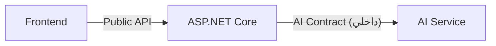

# integration-contracts.md — عقود التكامل (Backend ⇄ AI ⇄ Frontend)

> **كل عقود الـ AI في هذا الملف مؤقتة (PROVISIONAL)** — `contractVersion = "0.1-provisional"`.
> يجب عرضها على Members 2 و3 وتعديلها معاً **في اليوم 1**. أي تغيير يُرفع رقم النسخة.

---

## 1. الافتراضات (Assumptions) — يجب تأكيدها مع فريق الـ AI

| # | الافتراض | يتأكد من |
|---|---|---|
| A1 | خدمة الـ AI تُعرَض عبر HTTP/JSON (أياً كانت اللغة: Node.js أو Python). | فريق AI |
| A2 | تُصادَق بمفتاح ثابت في الرأس `X-Api-Key` (سر مشترك في الإعدادات). | فريق AI |
| A3 | زمن الاستجابة المتوقع 5–30 ثانية لتحليل Habitat، 3–20 ثانية للـ Knowledge. | قياس فعلي في اليوم 2 |
| A4 | فريق الـ AI يملك الـ RAG corpus والـ vector index؛ الـ Backend **لا** يملك نسخة منها. | فريق AI |
| A5 | الـ citations ترجع بمعرّفات (`externalSystem` + `externalId` أو `doi`) تُطابق `ResearchSource` عند الإمكان. | فريق AI + اختيار الـ dataset |
| A6 | **لا يوجد نموذج علمي مُتحقَّق منه** لتصنيف الخطر؛ الناتج تفسير مبني على LLM (± سياق مرجعي). إن وُجد نموذج فعلي، يخبرنا الفريق ليُضاف `analysisBasis = ValidatedModel`. | فريق AI |
| A7 | مفردات `riskLabel` يتفق عليها الفريق (مقترح: `Low`, `Moderate`, `High`, `Indeterminate`)، وهي **تسمية عرض** وليست عتبات علمية، ومن يحدّد منطقها هو الـ AI/المستند العلمي لا الـ Backend. | فريق AI |
| A8 | الـ AI يعيد نصاً بلغة الطلب (`language`) وإلا الإنجليزية. | فريق AI + Frontend |
| A9 | لا streaming في الـ MVP. | — |

---

## 2. فصل الـ endpoints



| الطبقة | Habitat | Knowledge | Health |
|---|---|---|---|
| **Public (ASP.NET ← Frontend)** | `POST /api/habitat-analyses` | `POST /api/knowledge/queries` | `GET /api/health` |
| **AI Contract (ASP.NET → AI)** | `POST {AiBaseUrl}/v1/habitat/analyze` | `POST {AiBaseUrl}/v1/knowledge/ask` | `GET {AiBaseUrl}/v1/health` |

الـ Frontend **لا يعرف** عناوين أو شكل عقد الـ AI. الـ Backend يترجم بين العقدين.

**رؤوس HTTP في اتجاه AI:**

| Header | القيمة |
|---|---|
| `X-Api-Key` | من الإعدادات (User Secrets / Environment Variable — لا يُرفع إلى Git) |
| `X-Correlation-Id` | نفس Id الطلب الأصلي |
| `Content-Type` / `Accept` | `application/json` |

---

## 3. العقد المؤقت 1 — Habitat Analysis

### 3.1 `POST /v1/habitat/analyze`

**Request (Backend → AI):**
```json
{
  "contractVersion": "0.1-provisional",
  "requestId": "0b8a6f5e-0a3b-4a56-9a64-7f5f0d3b1c22",
  "language": "en",
  "environment": {
    "code": "ISS",
    "name": "International Space Station",
    "type": "OrbitalStation"
  },
  "material": {
    "code": "MAT_EXAMPLE",
    "name": "Example material",
    "category": "Polymer",
    "properties": [
      { "name": "…", "value": 0.0, "unit": "…", "sourceDoi": null }
    ]
  },
  "conditions": {
    "oxygenPercent": 30.0,
    "pressureKPa": 101.3,
    "temperatureCelsius": 22.0,
    "gravityLevelG": 0
  },
  "additionalParameters": {},
  "referenceExperiments": [
    {
      "externalSystem": "PSI",
      "externalId": "…",
      "title": "…",
      "doi": "10.xxxx/placeholder",
      "url": "https://…",
      "parameters": [
        { "key": "OxygenConcentration", "valueNumeric": 21.0, "unit": "%" }
      ]
    }
  ]
}
```
- `referenceExperiments`: **اختياري**. الـ Backend يملؤه من SQL (تجارب لنفس المادة) ليكون الـ AI مُرتكزاً على بيانات موثّقة. إن فُرِّغ الحقل يعمل الـ AI بمعرفته/الـ RAG الخاص به.
- `properties`: من `MaterialProperty` إن وُجدت (قد تكون فارغة).

**Response (AI → Backend) — HTTP 200:**
```json
{
  "contractVersion": "0.1-provisional",
  "requestId": "0b8a6f5e-0a3b-4a56-9a64-7f5f0d3b1c22",
  "analysis": {
    "riskLabel": "Moderate",
    "analysisBasis": "LlmInterpretationOnly",
    "explanation": "…",
    "factors": [
      { "name": "Oxygen concentration", "description": "…", "direction": "IncreasesRisk" }
    ],
    "limitations": [ "…" ],
    "references": [
      {
        "externalSystem": "PSI",
        "externalId": "…",
        "doi": "10.xxxx/placeholder",
        "title": "…",
        "url": "https://…",
        "excerpt": "…"
      }
    ]
  },
  "model": { "provider": "…", "name": "…", "version": "…" },
  "warnings": []
}
```

**القيم المسموحة:**

| الحقل | القيم |
|---|---|
| `analysisBasis` | `LlmInterpretationOnly`, `ReferenceDataMatch`, `ValidatedModel` |
| `factors[].direction` | `IncreasesRisk`, `DecreasesRisk`, `Unclear` |

**حماية من الـ claims غير المدعومة (في الـ Backend):**
1. إن رجع `analysisBasis = ValidatedModel` ولم يُؤكَّد وجود نموذج (إعداد `AiService:ValidatedModelAvailable = false`) ← يُخفَّض إلى `LlmInterpretationOnly` ويُسجَّل تحذير.
2. إن غاب `limitations` يُضاف الـ limitation الافتراضي من الإعدادات.
3. الـ `disclaimer` يضيفه الـ Backend دائماً.

### 3.2 أخطاء الـ AI (شكل مقترح)

HTTP `4xx/5xx` مع:
```json
{ "error": { "code": "INVALID_INPUT", "message": "…", "retryable": false } }
```

| HTTP من الـ AI | تعامل الـ Backend | الرد للـ Frontend |
|---|---|---|
| `400/422` | `AiServiceRejectedException` — خطأ في عقدنا (bug) | `502` (`AI_INVALID_REQUEST`) |
| `401/403` | سوء إعداد المفتاح | `503` (`AI_UNAVAILABLE`) + سجل خطأ |
| `429` | rate-limited | `503` (`AI_BUSY`) |
| `5xx` | `AiServiceUnavailableException` | `503` |
| لا اتصال | نفس الأعلى | `503` |
| انتهاء المهلة | `AiServiceTimeoutException` | `504` (`AI_TIMEOUT`) |
| JSON غير قابل للـ parse أو حقول مطلوبة ناقصة | `AiServiceInvalidResponseException` | `502` (`AI_INVALID_RESPONSE`) |

---

## 4. العقد المؤقت 2 — Knowledge Assistant

### 4.1 `POST /v1/knowledge/ask`

**Request:**
```json
{
  "contractVersion": "0.1-provisional",
  "requestId": "a3d4a9f2-6d0f-4cf8-8f5a-5f1b9d7f2b10",
  "language": "en",
  "question": "How does oxygen concentration affect flame behavior in microgravity?",
  "filters": {
    "discipline": "CombustionScience",
    "materialCode": null,
    "yearFrom": null,
    "yearTo": null
  },
  "maxSources": 5
}
```

**Response (HTTP 200):**
```json
{
  "contractVersion": "0.1-provisional",
  "requestId": "a3d4a9f2-6d0f-4cf8-8f5a-5f1b9d7f2b10",
  "answer": "…",
  "citations": [
    {
      "externalSystem": "PSI",
      "externalId": "…",
      "doi": "10.xxxx/placeholder",
      "title": "…",
      "url": "https://…",
      "excerpt": "…",
      "relevanceScore": 0.82
    }
  ],
  "model": { "provider": "…", "name": "…", "version": "…" },
  "warnings": []
}
```

**ما يفعله الـ Backend بالرد:**
1. لكل citation: يبحث في `ResearchSource` بـ `(externalSystem, externalId)` ثم `doi` ← `Matched` أو `Unmatched`.
2. `GroundingStatus = HasCitations` إذا `citations.Count ≥ 1` وإلا `NoCitations`.
3. يحفظ `KnowledgeQuery` + `KnowledgeCitation`.
4. **لا ينشئ `ResearchSource` جديداً تلقائياً.**

### 4.2 `GET /v1/health`
```json
{ "status": "ok", "contractVersion": "0.1-provisional", "mode": "live" }
```
`mode` ∈ `live`, `degraded`.

---

## 5. تصميم الـ Integration في ASP.NET Core

### 5.1 الواجهة

```
IAiServiceClient
 ├─ Task<AiHabitatAnalysisResponse> AnalyzeHabitatAsync(AiHabitatAnalysisRequest, CancellationToken)
 ├─ Task<AiKnowledgeResponse>       AskKnowledgeAsync(AiKnowledgeRequest, CancellationToken)
 └─ Task<AiHealthResponse>          CheckHealthAsync(CancellationToken)

HttpAiServiceClient  : IAiServiceClient   (Typed HttpClient)
MockAiServiceClient  : IAiServiceClient   (بيانات ثابتة)
```

### 5.2 التسجيل (وصف، لا كود تنفيذ)

- يُسجَّل عبر `AddHttpClient<HttpAiServiceClient>(...)` مع `BaseAddress` من الإعدادات ورأس `X-Api-Key` الافتراضي.
- اختيار التنفيذ حسب `AiService:UseMock`: عندما `true` يُسجَّل `MockAiServiceClient` كـ `IAiServiceClient`، وإلا `HttpAiServiceClient`.
- الـ Services تعتمد على `IAiServiceClient` فقط، **لا تعرف أي تنفيذ**.

### 5.3 الإعدادات (`AiServiceOptions` عبر `IOptions`)

```json
"AiService": {
  "UseMock": true,
  "BaseUrl": "http://localhost:8000",
  "ApiKey": "<user-secrets / env var>",
  "HabitatTimeoutSeconds": 60,
  "KnowledgeTimeoutSeconds": 45,
  "HealthTimeoutSeconds": 5,
  "ContractVersion": "0.1-provisional",
  "ValidatedModelAvailable": false,
  "Disclaimers": {
    "Habitat": "AI-generated indicative analysis. Not scientifically validated. Do not use for safety decisions.",
    "Knowledge": "AI-generated answer based on retrieved documents. Verify against the cited sources."
  }
}
```

- `ApiKey`: User Secrets في التطوير؛ متغير بيئة في التشغيل. لا تضعه في `appsettings.json` المرفوع.
- التحقق من الإعدادات عند الإقلاع (`ValidateOnStart`): `BaseUrl` URI صالح عندما `UseMock=false`.

### 5.4 المهلات (Timeouts)

- `HttpClient.Timeout = Infinite`، والمهلة الفعلية لكل استدعاء عبر `CancellationTokenSource.CreateLinkedTokenSource(requestAborted)` + `CancelAfter(timeout)`. يسمح بمهلة مختلفة لكل عقد.
- إذا ألغى المستخدم الطلب (`RequestAborted`) يُلغى استدعاء الـ AI ويُعلَّم السجل `Failed` (`CLIENT_CANCELLED`).
- التمييز: `OperationCanceledException` مع `RequestAborted = false` ← `AiServiceTimeoutException`.

### 5.4.1 إعادة المحاولة (Retry)
**لا retry تلقائي** لطلبات `POST` للـ AI في الـ MVP (تكلفة LLM، ولا ضمان idempotency). المستخدم يعيد المحاولة من الواجهة. (Nice: retry واحد لأخطاء الاتصال فقط عبر `Microsoft.Extensions.Http.Resilience`.)

### 5.5 الاستثناءات

```
AiServiceException (base)
 ├─ AiServiceUnavailableException   → 503
 ├─ AiServiceTimeoutException       → 504
 ├─ AiServiceRejectedException      → 502 (AI رفض طلبنا: غالباً bug في عقدنا)
 └─ AiServiceInvalidResponseException → 502
```
`GlobalExceptionHandler` يحوّلها إلى `ProblemDetails`.

### 5.6 سلوك الـ Mock (مهم لأمانة العرض)

`MockAiServiceClient` يرجع ردوداً ثابتة **تُعلن أنها وهمية**:

| الحقل | القيمة في Mock |
|---|---|
| `analysisBasis` | `Mock` |
| `riskLabel` | `"Placeholder"` — **ليست** تصنيفاً حقيقياً |
| `explanation` | نص يقول صراحة إنه placeholder |
| `isMock` | `true` (يُضبط في الـ Backend وليس من الـ Mock نفسه) |

بهذا لا يمكن عرض مخرج وهمي كأنه تحليل. الـ Frontend يعرض **شريطاً بارزاً** "Demo data" عندما `isMock = true` أو `/api/health` يرجع `aiMode = Mock`.

أضف للـ Mock تأخيراً مصطنعاً (1–2 ث) وحالة فشل قابلة للتفعيل بإعداد (`Mock:SimulateFailure`) لاختبار واجهة الأخطاء.

---

## 6. متزامن أم غير متزامن؟ (توصية)

### التوصية: **متزامن (synchronous) في الـ MVP، مع تصميم يسمح بالتحول لاحقاً**

| المعيار | التحليل |
|---|---|
| زمن متوقع | 5–30 ث (A3، غير مؤكد). مقبول مع مؤشر تحميل. |
| تعقيد التنفيذ | sync: بسيط. async: يتطلب `BackgroundService` + `Channel` + DbContext scopes + polling في الـ Frontend ≈ يوم عمل إضافي تقريباً. |
| المخاطر | proxies/hosting قد تقطع الطلبات > 30–60 ث. |
| العرض (Demo) | sync يعطي تجربة أبسط وأكثر استقراراً. |

**ما تم لتسهيل التحول لـ async لاحقاً:**
- `HabitatAnalysis.Status` موجود (`Pending/Running/Completed/Failed`).
- `GET /api/habitat-analyses/{id}` موجود.
- الـ Frontend يتعامل مع `status` في الرد وليس فقط مع نجاح HTTP.

**متى نتحول إلى async؟** إذا قاس فريق الـ AI زمناً **P95 > 25 ثانية**، أو ظهرت timeouts على بيئة الاستضافة. عندها: `POST` يرجع `202 Accepted` + `Location` و`status = Running`، ويستعلم الـ Frontend كل 2 ث عبر `GET`.

للـ Knowledge: sync أيضاً (أقصر عادة).

---

## 7. عقد الـ Frontend (ملخص)

### 7.1 الشاشات والـ endpoints

| الشاشة | Endpoints | ملاحظات |
|---|---|---|
| **Habitat Stress-Test: النموذج** | `GET /api/environments`, `GET /api/materials` | عند اختيار بيئة تُعبَّأ الحقول من `defaults` إن لم تكن `null` |
| **Habitat: إرسال وعرض النتيجة** | `POST /api/habitat-analyses` | مؤشر تحميل حتى 60 ث |
| **Habitat: نتيجة محفوظة** | `GET /api/habitat-analyses/{id}` | لإعادة التحميل/المشاركة |
| **Knowledge Assistant** | `POST /api/knowledge/queries` | |
| **Knowledge: تفاصيل مصدر** | `GET /api/sources/{id}` | عند النقر على citation `Matched` |
| **Experiment Explorer** | `GET /api/experiments`, `GET /api/experiments/{id}` | |
| **Dual-Use Bridge: قائمة** | `GET /api/technologies?domain=` | |
| **Dual-Use Bridge: تفاصيل** | `GET /api/technologies/{id}` | |
| **شريط الحالة العام** | `GET /api/health` | يُظهر وضع Mock |

### 7.2 قواعد العرض الإلزامية (لحماية الأمانة العلمية)

1. عرض `disclaimer` دائماً بجوار أي نتيجة AI.
2. عرض شارة حسب `analysisBasis`: `LlmInterpretationOnly` ← "تفسير AI — غير مُتحقَّق علمياً".
3. عرض شارة "Demo data" عند `isMock = true`.
4. عرض citations `Unmatched` بشارة "مرجع غير موثّق في قاعدة بياناتنا".
5. عرض التطبيقات `TeamProposed` بشارة "اقتراح الفريق".
6. عدم عرض `riskLabel` كرقم أو نسبة احتمال أو لون "آمن" قاطع بدون الـ disclaimer.

### 7.3 CORS والأمان
- CORS يسمح فقط بأصل الـ Frontend (قيمة في الإعدادات).
- لا مفاتيح مزوّد AI في الـ Frontend إطلاقاً.
- Rate limiting على `POST /api/habitat-analyses` و`/api/knowledge/queries` (Nice): `AddRateLimiter` مدمج في .NET 8 — يحمي رصيد الـ LLM أثناء العرض.

---

## 8. سيناريوهات الفشل — جدول كامل

| السيناريو | أين يُكتشف | `errorCode` | HTTP | سلوك الـ Frontend المقترح |
|---|---|---|---|---|
| JSON غير صالح / حقول ناقصة | Model binding | `VALIDATION_ERROR` | 400 | إبراز الحقول |
| بيئة/مادة غير موجودة | Service | `ENVIRONMENT_NOT_FOUND` / `MATERIAL_NOT_FOUND` | 404 | رسالة + إعادة تحميل القوائم |
| معامل ناقص ولا افتراضي | Service | `MISSING_REQUIRED_PARAMETER` | 422 | طلب إدخال القيمة |
| قيمة تخالف حداً فيزيائياً | Validation | `VALUE_OUT_OF_PHYSICAL_RANGE` | 422 | إبراز الحقل |
| AI غير متاح / 5xx / 401 | `HttpAiServiceClient` | `AI_UNAVAILABLE` | 503 | زر "إعادة المحاولة" |
| AI مشغول (429) | | `AI_BUSY` | 503 | انتظار ثم إعادة |
| انتهاء المهلة | | `AI_TIMEOUT` | 504 | زر إعادة + رسالة |
| رد AI غير صالح | | `AI_INVALID_RESPONSE` | 502 | رسالة عامة (التفاصيل في السجل) |
| AI رفض الطلب (400) | | `AI_INVALID_REQUEST` | 502 | رسالة عامة + تنبيه للمطوّر |
| الـ Mock مفعّل | | — | 200 | شارة Demo |
| خطأ غير متوقع | GlobalExceptionHandler | `INTERNAL_ERROR` | 500 | رسالة عامة + `correlationId` |
| قاعدة البيانات غير متاحة | | `DATABASE_UNAVAILABLE` | 503 | |

**قاعدة:** لا تُرسَل رسائل استثناءات داخلية أو stack traces أو تفاصيل مزوّد الـ AI إلى الـ Frontend. تُسجَّل (`ILogger`) مع `correlationId`.

---

## 9. قائمة التنسيق المطلوبة

### مع فريق الـ AI (قبل نهاية اليوم 1)
1. مراجعة العقدين (§3, §4) وتعديل الحقول.
2. حسم: هل يوجد أي مصدر علمي/نموذج يبرر `ReferenceDataMatch` أو `ValidatedModel`؟
3. مفردات `riskLabel`.
4. شكل الـ citations ومعرّفاتها (هل `externalId` من PSI متاح؟ DOI؟).
5. لغة وبورت الخدمة وطريقة التشغيل المحلي (Docker؟).
6. الأزمنة المتوقعة (P50/P95) وحد المهلة.
7. هل سيقدمون **Mock server** أو ملف OpenAPI حتى نختبر مبكراً؟ (بالمقابل نعطيهم JSON الأمثلة أعلاه ليبنوا عليها).

### مع فريق الـ Frontend
1. اعتماد `api-specification.md`، وفتح Swagger لهم من اليوم 2.
2. التقنية وأصل CORS.
3. التزام عرض قواعد §7.2.
4. حدود المهلة في الـ client (≥ 65 ث لـ Habitat).
