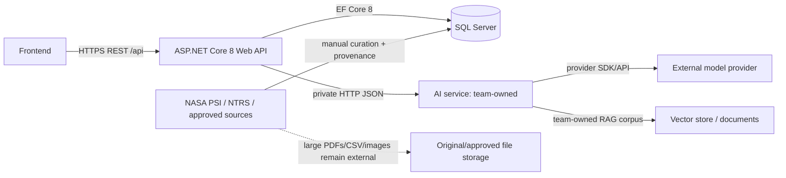

# Architecture — NASA Fire Safety Intelligence Platform

## القرار التنفيذي

استخدم **Modular Monolith**: مشروع ASP.NET Core 8 واحد، SQL Server واحد، وAI service مستقل لا يملكه backend. الاسم الصحيح هو `HabitatAnalysis`، وليس `Simulation`: النظام ينسّق مدخلات ويفسر بيانات/مخرجات AI، ولا يملك نموذج احتراق أو محاكاة علمية متحققاً منها.



**الملكية والثقة:** frontend يثق بالـ API فقط؛ API هو مالك catalog وسجل الطلبات وprovenance في SQL؛ فريق AI مالك prompts/RAG/provider credential؛ PSI مصدر خارجي غير موثوق كـ runtime dependency. AI response مدخل خارجي غير موثوق ويجب validate قبل حفظه. لا يملك frontend اتصال SQL أو AI credentials.

```mermaid
sequenceDiagram
 participant FE as Frontend
 participant API as ASP.NET API
 participant DB as SQL Server
 participant AI as AI Service
 FE->>API: POST /api/habitat-analyses
 API->>DB: validate environment/material; save Running request
 API->>AI: POST /v1/habitat/analyze (internal contract)
 alt valid reply before timeout
   AI-->>API: interpretation + raw citations
   API->>DB: validate, match citations, persist result
   API-->>FE: 201 analysis response + backend disclaimer
 else unavailable/timeout/invalid reply
   API->>DB: mark Failed, retain safe error code
   API-->>FE: ProblemDetails 503/504/502 + analysisId
 end
```

## مسؤوليات ومخاطر الفشل

| المكوّن | مسؤولية | failure behavior |
|---|---|---|
| API | validation، persistence، citation matching، public DTOs، disclaimer | لا يمرر provider error؛ يحفظ Failure ويعيد ProblemDetails |
| SQL | catalog المصدر، records، audit/provenance | `503 DATABASE_UNAVAILABLE`؛ لا fallback مزيف |
| AI service | RAG/model/prompt وإرجاع contract | timeout/unavailable = `504/503`؛ لا retry POST تلقائي في MVP |
| PSI | مصدر اختيار/تنزيل يدوي | لا يوقف runtime؛ يعرض catalog الموجود فقط |

## الهيكل المقترح (بعد التنفيذ، مع الحفاظ على المشروع الحالي)

```text
Controllers/          public HTTP endpoints فقط
Data/                 FireSafetyDbContext, Seed/ (curated JSON only)
Entities/             EF entities and enums (بدل Models/ لتفادي غموض DTO)
Configurations/       IEntityTypeConfiguration<T>
DTOs/Common|Catalog|Habitat|Knowledge|Technology/
Services/             use-cases and mapping orchestration
Interfaces/           service abstractions
Integrations/Ai/      typed HttpClient, AI-only contracts, mock implementation
Options/              bound/validated settings classes
Validators/           request validation (DataAnnotations أو lightweight custom)
Middleware/           correlation ID; global exception handler
```

لا حاجة حالياً إلى Repository pattern عام فوق EF Core؛ `DbContext` + service محدد لكل use-case أبسط وأكثر قابلية للتسليم. لا تنشئ طبقات Clean Architecture أو projects متعددة في MVP.

## قرارات مبررة

| القرار | البديل | المزايا/العيوب | MVP |
|---|---|---|---|
| Modular Monolith | microservices | أقل deployment/debugging؛ لا استقلال deploy داخلي | مطلوب |
| EF Core Code First + fluent configurations | Dapper/database-first | migrations وconstraints في الكود؛ أقل تحكم SQL يدوي | مطلوب |
| Catalog SQL مُنتقى | تحميل كل PSI/runtime API | قابل للعرض وprovenance واضح؛ تغطية محدودة | مطلوب |
| hybrid controlled parameters | أعمدة ثابتة أو JSON/EAV حر | مرونة مع keys مضبوطة؛ queries أوسع قليلاً | مطلوب |
| typed `HttpClient` خلف `IAiClient` | controller calls/provider مباشرة | قابل للاستبدال/mock؛ طبقة إضافية صغيرة | مطلوب |
| synchronous POST | queue/background jobs | أقل تعقيداً؛ يتأثر بالـ timeout؛ فشل محفوظ يعاد بجلب `analysisId` | مطلوب الآن؛ async لاحقاً إذا P95 أو hosting يثبت المشكلة |

## النطاق

**Must:** catalog مصغر موثق، Habitat/Knowledge عبر mock ثم AI، citations، Technology explorer مع `TechnologyExperiment`، Swagger/error handling. **Should:** history lists، health، CORS المحدد، `MaterialProperty`، `TechnologySource`، basic rate limit. **Nice:** coverage warnings. **Future:** async jobs، auth، full text/vector search في backend، PSI importer، validated-model registry/workflow.

## قاعدة الأمانة العلمية

البيانات التجريبية في `Experiment*` ومصادرها منفصلة عن `HabitatAnalysis` و`KnowledgeQuery` المولّدة. backend يحدد `AnalysisBasis`: Mock للـ mock، و`LlmInterpretationOnly` لكل رد HTTP في MVP. لا يسمح لقيمة AI بأن تعلن `ValidatedModel`; هذا يتطلب registry مستقلًا معتمدًا وهو خارج MVP. كل output يحمل `analysisBasis`, `isMock`, citations, limitations وdisclaimer يضيفه backend.

