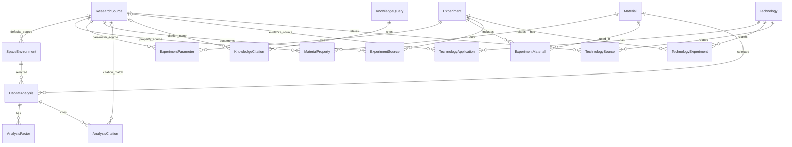

# Database design — SQL Server / EF Core Code First

> Revision 2026-11-11. تصميم للمراجعة قبل أول migration فقط. `NN` required و`?` nullable؛ كل timestamps UTC.

## قواعد ونطاق

- Catalog PK: `int IDENTITY`، history/request PK: application-generated `Guid`/`uniqueidentifier`. كل `CreatedAt` أو `RequestedAt` ذات default تستخدم `SYSUTCDATETIME()`؛ لا defaults علمية أو results.
- Enums/status هي `nvarchar` + `CHECK`؛ القيم العلمية `decimal` لا `float`.
- `ResearchSource.Origin` يصف أصل البحث (`NasaOriginal`/`ThirdParty`) فقط. حالة مراجعة metadata مستقلة في `CurationStatus`؛ لا تصبح team curation مصدرًا علميًا جديدًا.
- **MVP:** كل الكيانات أدناه عدا `MaterialProperty` و`TechnologySource` (Should). `TechnologyExperiment` هو MVP لأن Technology Details يعرض related experiments.

## ERD



## Habitat inputs: unknown ليس default

`HabitatAnalysis` يحتفظ بـ nullable snapshots: `OxygenVolumePercent?`, `PressureKPa?`, `TemperatureCelsius?`, `GravityRegime?`, `EffectiveGravityG?`. `InputOriginsJson` required JSON يسجل لكل field: `UserProvided`, `SourcedDefault`, أو `Missing` مع source ID عند default. الغائب يظل `null` ولا يتحول لصفر.

`SourcedDefault` مسموح فقط إذا كانت القيمة في `SpaceEnvironment` ولها `DefaultsSourceId` ذي `CurationStatus=ApprovedForDisplay`. `UserProvided` أصل إدخال لا claim علمي. `OxygenVolumePercent` يعني volume percentage of O2 in gas mixture؛ أي basis آخر يحتاج field/unit منفصل.

`GravityRegime`: `Microgravity`, `ReducedGravity`, `EarthLike`, `Hypergravity`, `Unspecified`. `Microgravity` ليست zero gravity؛ `EffectiveGravityG` يمكن أن يبقى null أو قيمة موجبة موثقة. zero لا يستنتج من `Microgravity`.

Backend وحده يحدد required inputs عبر `AiCapabilityProfile` مُعتمد ومُرقّم versioned حسب `environmentCode`, `materialCode`, وAI contract version. قبل توفر profile لا يفرض schema حقولًا علمية ويبعث unknowns مع warning. عند وجود profile، Missing key مطلوب ينتج `422 AI_REQUIRED_INPUT_MISSING`. لا يوجد invented fallback.

## Entity specifications

### `ResearchSource` — MVP

الغرض: provenance لسجل dataset/publication أصلي.

| Property | C# / SQL Server | null/default | key, index, check, delete |
|---|---|---|---|
| `Id` | `int` / `int IDENTITY` | NN | PK |
| `Title` | `string` / `nvarchar(500)` | NN | `IX_ResearchSources_Title` |
| `SourceType` | `string` / `nvarchar(30)` | NN | CHECK `PsiDataset,NasaPublication,JournalArticle,TechnicalReport,Other` |
| `Origin` | `string` / `nvarchar(20)` | NN | CHECK `NasaOriginal,ThirdParty` |
| `ExternalSystem` | `string?` / `nvarchar(50)` | null | filtered unique external pair |
| `ExternalId` | `string?` / `nvarchar(200)` | null | filtered unique external pair |
| `DoiNormalized` | `string?` / `nvarchar(255)` | null | filtered unique DOI |
| `SourceUrl` | `string?` / `nvarchar(2000)` | null | no index |
| `Publisher` | `string?` / `nvarchar(200)` | null | — |
| `PublicationDate` | `DateOnly?` / `date` | null | — |
| `CitationText` | `string?` / `nvarchar(1500)` | null | — |
| `LicenseText` | `string?` / `nvarchar(300)` | null | — |
| `CurationStatus` | `string` / `nvarchar(30)` | NN; `Draft` | CHECK `Draft,MetadataReviewed,ApprovedForDisplay` |
| `AccessedAt` | `DateTime?` / `datetime2(3)` | null | — |
| `CreatedAt` | `DateTime` / `datetime2(3)` | NN; UTC default | — |

`UX_ResearchSources_External`: `(ExternalSystem,ExternalId)` unique where both non-null. `UX_ResearchSources_DoiNormalized`: unique where non-null. DOI normalize before save/match: trim, invariant lowercase, remove resolver prefix (`https://doi.org/`, `http://dx.doi.org/`, `doi:`), remove internal whitespace and one trailing punctuation; reject malformed DOI. Delete: Restrict from `SpaceEnvironment`, `ExperimentSource`, `ExperimentParameter`, `TechnologySource`; SetNull from citations/applications/properties.

### `SpaceEnvironment` — MVP

الغرض: selectable habitat and sourced optional defaults.

| Property | C# / SQL Server | null/default | key, index, check, delete |
|---|---|---|---|
| `Id` | `int` / `int IDENTITY` | NN | PK |
| `Code` | `string` / `nvarchar(30)` | NN | unique |
| `Name` | `string` / `nvarchar(100)` | NN | — |
| `EnvironmentType` | `string` / `nvarchar(30)` | NN | CHECK `OrbitalStation,LunarSurface,MarsSurface,Other` |
| `Description` | `string?` / `nvarchar(1000)` | null | — |
| `DefaultOxygenVolumePercent` | `decimal?` / `decimal(5,2)` | null | CHECK null or 0..100 |
| `DefaultPressureKPa` | `decimal?` / `decimal(9,3)` | null | CHECK null or >0 |
| `DefaultTemperatureCelsius` | `decimal?` / `decimal(6,2)` | null | CHECK null or >= -273.15 |
| `DefaultGravityRegime` | `string?` / `nvarchar(20)` | null | gravity CHECK |
| `DefaultEffectiveGravityG` | `decimal?` / `decimal(8,6)` | null | CHECK null or >=0; requires regime |
| `DefaultsSourceId` | `int?` / `int` | null | FK ResearchSource SetNull; index |
| `IsActive` | `bool` / `bit` | NN; `1` | — |
| `CreatedAt` | `DateTime` / `datetime2(3)` | NN; UTC default | — |

Gravity CHECK allows the five `GravityRegime` values above. Delete from `HabitatAnalysis` is Restrict.
`CK_SpaceEnvironments_DefaultSource`: when any `Default*` value is non-null, `DefaultsSourceId IS NOT NULL`; the cross-table requirement that source status is `ApprovedForDisplay` is enforced by the backend/seeder because a SQL CHECK cannot inspect another table.

### `Material` — MVP

| Property | C# / SQL Server | null/default | key, index, check, delete |
|---|---|---|---|
| `Id` | `int` / `int IDENTITY` | NN | PK |
| `Code` | `string` / `nvarchar(50)` | NN | unique |
| `Name` | `string` / `nvarchar(150)` | NN | — |
| `Category` | `string?` / `nvarchar(50)` | null | `IX_Materials_Category` |
| `Description` | `string?` / `nvarchar(1000)` | null | — |
| `IsActive` | `bool` / `bit` | NN; `1` | — |
| `CreatedAt` | `DateTime` / `datetime2(3)` | NN; UTC default | — |

Delete: Restrict from Analysis/ExperimentMaterial; Cascade to MaterialProperty.

### `MaterialProperty` — Should Have

الغرض: قيمة curated واحدة لكل property key، وليست raw measurements.

| Property | C# / SQL Server | null/default | key, index, check, delete |
|---|---|---|---|
| `Id` | `int` / `int IDENTITY` | NN | PK |
| `MaterialId` | `int` / `int` | NN | FK Material Cascade; unique with PropertyKey |
| `PropertyKey` | `string` / `nvarchar(80)` | NN | controlled key vocabulary |
| `DisplayName` | `string` / `nvarchar(150)` | NN | — |
| `ValueType` | `string` / `nvarchar(10)` | NN | CHECK `Numeric,Text` |
| `ValueNumber` | `decimal?` / `decimal(18,6)` | null | Numeric only |
| `ValueText` | `string?` / `nvarchar(500)` | null | Text only |
| `Unit` | `string?` / `nvarchar(40)` | null | explicit when applicable |
| `Uncertainty` | `decimal?` / `decimal(18,6)` | null | >=0; Numeric only |
| `ResearchSourceId` | `int?` / `int` | null | FK Source SetNull; index |
| `CreatedAt` | `DateTime` / `datetime2(3)` | NN; UTC default | — |

CHECK: Numeric has only `ValueNumber`; Text has only `ValueText`; `Uncertainty` only Numeric.

### `Experiment` — MVP

الغرض: curated investigation summary، لا file/data replica.

| Property | C# / SQL Server | null/default | key, index, check, delete |
|---|---|---|---|
| `Id` | `int` / `int IDENTITY` | NN | PK |
| `Title` | `string` / `nvarchar(300)` | NN | title index |
| `ExternalSystem` | `string?` / `nvarchar(50)` | null | filtered unique pair |
| `ExternalId` | `string?` / `nvarchar(200)` | null | filtered unique pair |
| `Discipline` | `string` / `nvarchar(50)` | NN | composite index with GravityCondition |
| `Platform` | `string?` / `nvarchar(100)` | null | — |
| `GravityCondition` | `string?` / `nvarchar(30)` | null | composite index |
| `Summary` | `string` / `nvarchar(max)` | NN | — |
| `KeyFindings` | `string?` / `nvarchar(max)` | null | source-backed only |
| `CurationStatus` | `string` / `nvarchar(30)` | NN; `Draft` | same curation CHECK |
| `CuratedAt` | `DateTime?` / `datetime2(3)` | null | — |
| `CreatedAt` | `DateTime` / `datetime2(3)` | NN; UTC default | — |

Filtered unique external pair. Delete Cascade to parameters/links. A service/seeder rule requires `ExperimentSource.Role=Primary` before `ApprovedForDisplay`.

### `ExperimentParameter` — MVP

الغرض: **summary parameter** curated لتجربة؛ raw repeated observations/time series تبقى ملفات خارج SQL.

| Property | C# / SQL Server | null/default | key, index, check, delete |
|---|---|---|---|
| `Id` | `int` / `int IDENTITY` | NN | PK |
| `ExperimentId` | `int` / `int` | NN | FK Experiment Cascade; index |
| `ParameterKey` | `string` / `nvarchar(80)` | NN | controlled vocabulary; non-unique |
| `Category` | `string` / `nvarchar(20)` | NN | CHECK `Condition,Measurement,Result` |
| `DisplayName` | `string` / `nvarchar(150)` | NN | — |
| `OriginalLabel` | `string?` / `nvarchar(150)` | null | source wording |
| `ValueType` | `string` / `nvarchar(10)` | NN | CHECK `Numeric,Text,Range` |
| `ValueNumber` | `decimal?` / `decimal(18,6)` | null | Numeric only |
| `ValueText` | `string?` / `nvarchar(500)` | null | Text only |
| `ValueMin` | `decimal?` / `decimal(18,6)` | null | Range only |
| `ValueMax` | `decimal?` / `decimal(18,6)` | null | Range only; min <= max |
| `Unit` | `string?` / `nvarchar(40)` | null | explicit for numeric/range when applicable |
| `Uncertainty` | `decimal?` / `decimal(18,6)` | null | >=0; Numeric only |
| `ResearchSourceId` | `int` / `int` | NN | FK Source Restrict; index |
| `CreatedAt` | `DateTime` / `datetime2(3)` | NN; UTC default | — |

No `UNIQUE(ExperimentId,ParameterKey)`: key can recur for different specimens, conditions or sources. Index `(ExperimentId,ParameterKey)`; reviewer controls near-duplicates by `(ExperimentId,ParameterKey,Category,ResearchSourceId,OriginalLabel)`. The migration-level constraint is:

```sql
CONSTRAINT CK_ExperimentParameters_ValueShape CHECK (
  (ValueType = 'Numeric' AND ValueNumber IS NOT NULL AND ValueText IS NULL AND ValueMin IS NULL AND ValueMax IS NULL)
  OR (ValueType = 'Text' AND ValueText IS NOT NULL AND ValueNumber IS NULL AND ValueMin IS NULL AND ValueMax IS NULL)
  OR (ValueType = 'Range' AND ValueMin IS NOT NULL AND ValueMax IS NOT NULL AND ValueMin <= ValueMax AND ValueNumber IS NULL AND ValueText IS NULL)
),
CONSTRAINT CK_ExperimentParameters_Uncertainty CHECK (Uncertainty IS NULL OR (ValueType = 'Numeric' AND Uncertainty >= 0))
```

### Join tables

| Entity / purpose | Property | C# / SQL Server | null/default | key/FK/delete/index |
|---|---|---|---|---|
| `ExperimentMaterial` — material role | `ExperimentId` | `int` / `int` | NN | composite PK; FK Experiment Cascade |
| | `MaterialId` | `int` / `int` | NN | composite PK; FK Material Restrict; inverse index |
| | `Role` | `string?` / `nvarchar(30)` | null | — |
| `ExperimentSource` — documentation relation | `ExperimentId` | `int` / `int` | NN | composite PK; FK Experiment Cascade |
| | `ResearchSourceId` | `int` / `int` | NN | composite PK; FK Source Restrict; inverse index |
| | `Role` | `string` / `nvarchar(20)` | NN | CHECK `Primary,Dataset,Publication,Related` |
| `TechnologyExperiment` — evidence relation | `TechnologyId` | `int` / `int` | NN | composite PK; FK Technology Cascade |
| | `ExperimentId` | `int` / `int` | NN | composite PK; FK Experiment Restrict; inverse index |
| `TechnologySource` — direct additional source (Should) | `TechnologyId` | `int` / `int` | NN | composite PK; FK Technology Cascade |
| | `ResearchSourceId` | `int` / `int` | NN | composite PK; FK Source Restrict; inverse index |

`TechnologyExperiment` is MVP; `TechnologySource` is Should because `TechnologyApplication.ResearchSourceId` suffices for MVP display evidence.

### `HabitatAnalysis` — MVP

الغرض: immutable request snapshot + status + result aggregate؛ لا جدول 1:1 منفصل.

| Property | C# / SQL Server | null/default | key, index, check, delete |
|---|---|---|---|
| `Id` | `Guid` / `uniqueidentifier` | NN | PK; app-generated |
| `SpaceEnvironmentId` | `int` / `int` | NN | FK Environment Restrict; composite index |
| `MaterialId` | `int` / `int` | NN | FK Material Restrict; composite index |
| `OxygenVolumePercent` | `decimal?` / `decimal(5,2)` | null | null or 0..100 |
| `PressureKPa` | `decimal?` / `decimal(9,3)` | null | null or >0 |
| `TemperatureCelsius` | `decimal?` / `decimal(6,2)` | null | null or >=-273.15 |
| `GravityRegime` | `string?` / `nvarchar(20)` | null | gravity regime CHECK |
| `EffectiveGravityG` | `decimal?` / `decimal(8,6)` | null | null or >=0; requires regime |
| `InputOriginsJson` | `string` / `nvarchar(max)` | NN | valid JSON; field origins/source IDs |
| `AdditionalParametersJson` | `string?` / `nvarchar(max)` | null | null or valid JSON |
| `Status` | `string` / `nvarchar(20)` | NN; `Pending` | CHECK `Pending,Running,Completed,Failed` |
| `RiskLabel` | `string?` / `nvarchar(30)` | null | presentation label, not threshold |
| `AnalysisBasis` | `string?` / `nvarchar(40)` | null | CHECK `Mock,LlmInterpretationOnly,ValidatedModel` |
| `IsMock` | `bool` / `bit` | NN; `0` | backend-owned |
| `Explanation` / `Limitations` | `string?` / `nvarchar(max)` | null | — |
| `ModelName` / `ModelVersion` | `string?` / `nvarchar(100/50)` | null | — |
| `ContractVersion` | `string?` / `nvarchar(30)` | null | — |
| `ErrorCode` / `ErrorMessage` | `string?` / `nvarchar(50/1000)` | null | sanitized failure only |
| `CorrelationId` | `Guid` / `uniqueidentifier` | NN | index |
| `RequestedAt` / `CompletedAt` | `DateTime` / `datetime2(3)` | NN UTC default / null | RequestedAt DESC index |
| `DurationMs` | `int?` / `int` | null | null or >=0 |

Index `(SpaceEnvironmentId,MaterialId,RequestedAt)`. Factors/citations Cascade. Service invariants: `Completed` has basis/explanation; Failed has error code; `Mock` iff `IsMock`; real MVP completion is exactly `LlmInterpretationOnly`. `ValidatedModel` requires an independently registered/approved backend model and is unavailable in MVP; API `isScientificallyValidated` is therefore false.

Migration checks: `CK_HabitatAnalyses_Oxygen` = `OxygenVolumePercent IS NULL OR OxygenVolumePercent BETWEEN 0 AND 100`; pressure/temperature/effective-g use the null-or bounds shown in the table; `CK_HabitatAnalyses_Gravity` requires a regime when effective g is present; both JSON fields use `ISJSON(...) = 1` when non-null. Completion/state cross-field rules are service-level so partial transient state is possible inside one transaction but never returned as final.

### Analysis children — MVP

| Entity | Property | C# / SQL Server | null/default | key/FK/check/delete |
|---|---|---|---|---|
| `AnalysisFactor` | `Id` | `int` / `int IDENTITY` | NN | PK |
| | `HabitatAnalysisId` | `Guid` / `uniqueidentifier` | NN | FK Analysis Cascade; unique with SortOrder |
| | `Name` | `string` / `nvarchar(150)` | NN | — |
| | `Description` | `string?` / `nvarchar(1000)` | null | — |
| | `Direction` | `string?` / `nvarchar(20)` | null | CHECK `IncreasesRisk,DecreasesRisk,Unclear` |
| | `SortOrder` | `int` / `int` | NN | >=0 |
| `AnalysisCitation` | `Id` | `int` / `int IDENTITY` | NN | PK |
| | `HabitatAnalysisId` | `Guid` / `uniqueidentifier` | NN | FK Analysis Cascade; unique with SortOrder |
| | `ResearchSourceId` | `int?` / `int` | null | FK Source SetNull; index |
| | `MatchStatus` | `string` / `nvarchar(20)` | NN | CHECK `Matched,Unmatched` |
| | `RawTitle` / `RawUrl` | `string?` / `nvarchar(500/2000)` | null | — |
| | `RawDoiNormalized` | `string?` / `nvarchar(255)` | null | normalized backend value |
| | `RawExternalSystem` / `RawExternalId` | `string?` / `nvarchar(50/200)` | null | — |
| | `Excerpt` | `string?` / `nvarchar(2000)` | null | — |
| | `SortOrder` | `int` / `int` | NN | >=0 |

Citation CHECK: Matched requires SourceId; Unmatched needs raw title/URL/DOI/external identifier.

### `KnowledgeQuery` / `KnowledgeCitation` — MVP

| Entity | Property | C# / SQL Server | null/default | key/FK/check/delete |
|---|---|---|---|---|
| `KnowledgeQuery` | `Id` | `Guid` / `uniqueidentifier` | NN | PK app-generated |
| | `Question` | `string` / `nvarchar(2000)` | NN | — |
| | `FiltersJson` | `string?` / `nvarchar(max)` | null | null or valid JSON |
| | `Answer` | `string?` / `nvarchar(max)` | null | — |
| | `Status` | `string` / `nvarchar(20)` | NN; `Pending` | same status CHECK |
| | `GroundingStatus` | `string?` / `nvarchar(30)` | null | CHECK `HasMatchedCitations,HasOnlyUnmatchedCitations,NoCitations` |
| | `IsMock` | `bool` / `bit` | NN; `0` | independent execution mode |
| | `ModelName` / `ModelVersion` | `string?` / `nvarchar(100/50)` | null | — |
| | `ContractVersion` | `string?` / `nvarchar(30)` | null | — |
| | `ErrorCode` / `ErrorMessage` | `string?` / `nvarchar(50/1000)` | null | — |
| | `CorrelationId` | `Guid` / `uniqueidentifier` | NN | index |
| | `RequestedAt` / `CompletedAt` | `DateTime` / `datetime2(3)` | NN UTC default / null | RequestedAt DESC index |
| | `DurationMs` | `int?` / `int` | null | null or >=0 |
| `KnowledgeCitation` | `Id` | `int` / `int IDENTITY` | NN | PK |
| | `KnowledgeQueryId` | `Guid` / `uniqueidentifier` | NN | FK Query Cascade; unique with SortOrder |
| | `ResearchSourceId` | `int?` / `int` | null | FK Source SetNull; index |
| | `MatchStatus` | `string` / `nvarchar(20)` | NN | matched/unmatched CHECK |
| | `RawTitle` / `RawUrl` | `string?` / `nvarchar(500/2000)` | null | — |
| | `RawDoiNormalized` | `string?` / `nvarchar(255)` | null | — |
| | `RawExternalSystem` / `RawExternalId` | `string?` / `nvarchar(50/200)` | null | — |
| | `Excerpt` | `string?` / `nvarchar(2000)` | null | — |
| | `RelevanceScore` | `decimal?` / `decimal(5,4)` | null | null or 0..1 |
| | `SortOrder` | `int` / `int` | NN | >=0 |

Backend computes GroundingStatus after matching: any matched → `HasMatchedCitations`; citations with none matched → `HasOnlyUnmatchedCitations`; none → `NoCitations`. It is independent from `IsMock` and says nothing about factual correctness.

### `Technology` / `TechnologyApplication` — MVP

| Entity | Property | C# / SQL Server | null/default | key/FK/check/delete |
|---|---|---|---|---|
| `Technology` | `Id` | `int` / `int IDENTITY` | NN | PK |
| | `Slug` | `string` / `nvarchar(100)` | NN | unique |
| | `Name` | `string` / `nvarchar(200)` | NN | — |
| | `Category` | `string` / `nvarchar(30)` | NN | CHECK `FireDetection,FireSuppression,SmokeMonitoring,BuildingSafety,Other`; index |
| | `Summary` | `string` / `nvarchar(1000)` | NN | — |
| | `Description` / `SpaceOriginSummary` | `string?` / `nvarchar(max)` | null | — |
| | `IsPublished` | `bool` / `bit` | NN; `0` | — |
| | `CreatedAt` | `DateTime` / `datetime2(3)` | NN; UTC default | — |
| | `UpdatedAt` | `DateTime` / `datetime2(3)` | NN; no DB default | application writes on create/update |
| `TechnologyApplication` | `Id` | `int` / `int IDENTITY` | NN | PK |
| | `TechnologyId` | `int` / `int` | NN | FK Technology Cascade; unique with SortOrder |
| | `Domain` | `string` / `nvarchar(10)` | NN | CHECK `Space,Earth` |
| | `Title` | `string` / `nvarchar(200)` | NN | — |
| | `Description` | `string` / `nvarchar(max)` | NN | — |
| | `EvidenceLevel` | `string` / `nvarchar(30)` | NN | CHECK `DocumentedInSource,TeamProposed` |
| | `ResearchSourceId` | `int?` / `int` | null | FK Source SetNull; index |
| | `SortOrder` | `int` / `int` | NN | >=0 |

CHECK: `DocumentedInSource` requires ResearchSourceId. `TeamProposed` is exposed/labeled. `TechnologyExperiment` supplies MVP `relatedExperiments`; `TechnologySource` remains Should for non-application direct sources.

## PSI and raw data boundary

SQL holds curated metadata, identifiers, summary parameters, provenance, and links. PSI/approved storage retains raw CSV, repeated samples, time series, imagery and PDFs. Missing/inconsistent values remain absent or textual with `OriginalLabel`; they are never invented.

## Revision summary

- Nullable Habitat inputs with explicit origin; categorical gravity plus optional effective g.
- `ExperimentParameter` now has source FK, `ValueType`, exact compatibility CHECKs and no inappropriate unique key.
- Grounding and mock mode separated; TechnologyExperiment promoted to MVP.
- DOI normalization and explicit curation states added.
- All schema tables expose properties, types, nullability, constraints, indexes and delete behavior.
